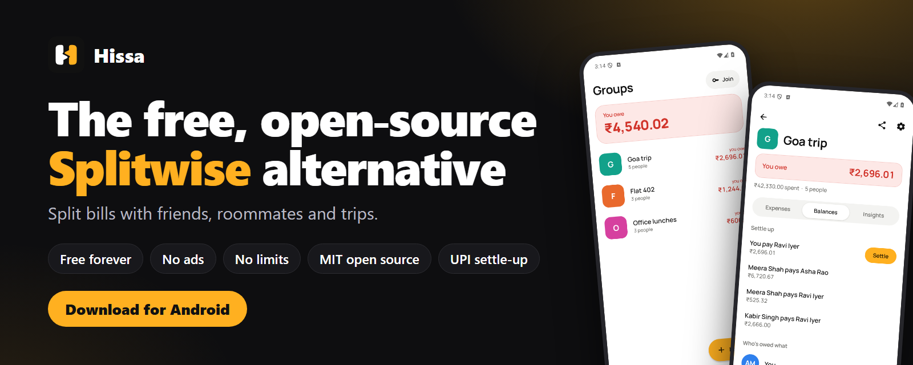
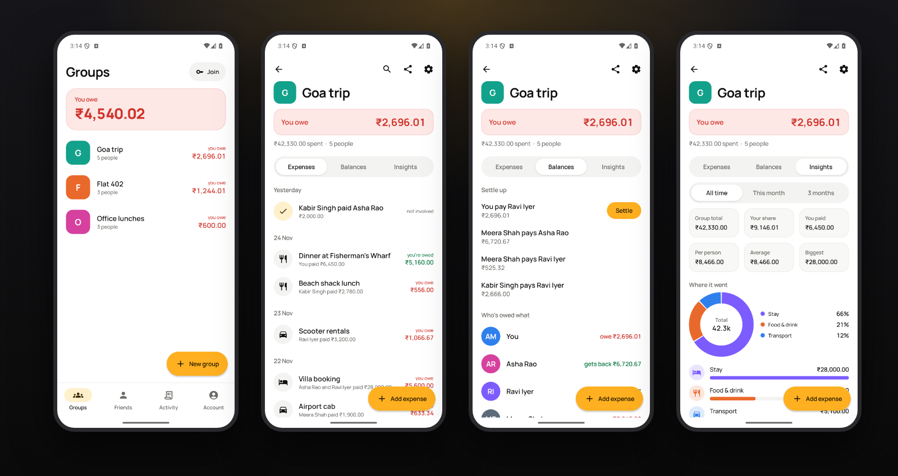
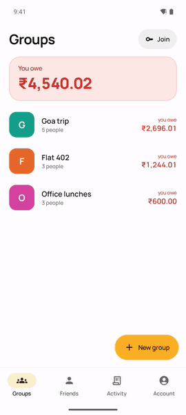
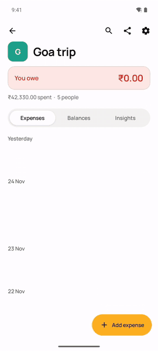
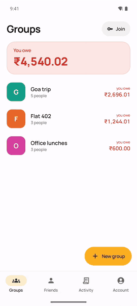
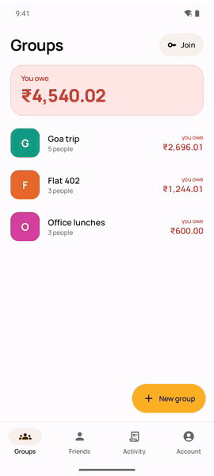

<div align="center">

<a href="https://github.com/MayankPunghal/Hissa/releases/latest"></a>

# Hissa: the free, open-source Splitwise alternative

**Split bills with friends, roommates and travel groups. No ads. No daily limits. No paywall. Your data stays yours.**

[](https://github.com/MayankPunghal/Hissa/stargazers)
[](https://github.com/MayankPunghal/Hissa/releases/latest)
[](LICENSE)
[](https://github.com/MayankPunghal/Hissa/actions/workflows/release.yml)


**[⬇ Download the APK](https://github.com/MayankPunghal/Hissa/releases/latest)** &nbsp;·&nbsp; **[⚡ Set up in 10 minutes](#quick-start)** &nbsp;·&nbsp; **[✨ Features](#what-you-get)** &nbsp;·&nbsp; **[📱 Web app](https://mayankpunghal.github.io/Hissa/app/)** &nbsp;·&nbsp; **[🌐 Website](https://mayankpunghal.github.io/Hissa/)**

<br>



</div>

**Hissa** is a free and open-source expense splitter for Android and the web, built as an alternative to **Splitwise**, Splid and Tricount. Track shared expenses in groups, see who owes whom, simplify debts and settle up, all without ads, expense limits or a subscription. It runs on your own free [Supabase](https://supabase.com) project, so there is no company in the middle and your data stays with you. Licensed under the [MIT License](LICENSE).

> ⭐ **If Hissa saves you from an awkward "who paid for what" chat, please [star the repo](https://github.com/MayankPunghal/Hissa). It is the single best way to help other people find it.**


---

## See it work

<p align="center">
  
  
  
  
</p>

<p align="center"><sub>Tour &nbsp;·&nbsp; Add an expense &nbsp;·&nbsp; Settle up &nbsp;·&nbsp; Dark mode</sub></p>

<sub>Recorded on the Android emulator with the built-in demo data, so nothing here is a real person.</sub>

---

## Why Hissa instead of Splitwise?

| | **Hissa** | Splitwise (free) |
|---|:---:|:---:|
| Price | **Free forever** | Free tier with limits, paid Pro |
| Ads | **None** | Yes |
| Daily expense limit | **None** | Yes on the free plan |
| Open source (MIT) | **Yes, read and change every line** | No |
| Your data | **In your own database, export any time** | On their servers |
| Itemised bills with tax and tip | **Free** | Pro |
| Receipt photos on an expense | **Free** | Pro |
| Charts and CSV export | **Free** | Pro |
| Pay by UPI in one tap | **Yes** | No |
| Self-hostable | **Yes** | No |
| Platforms | Android and installable web app | Android, iOS, web |

Honest trade-off: Hissa has an Android app and an installable web app (no native iOS app yet), and you (or one friend) create a free Supabase project once, which takes about 10 minutes. After that everyone just installs the app. If you want zero setup and iOS, Splitwise is the easier pick. If you want free, private and open, use Hissa.

Splitwise is a trademark of its owner. Hissa is an independent project and is not affiliated with Splitwise. Comparison reflects Splitwise's public plans at the time of writing and may change.

---

## Quick start

You need: an Android phone, a free Supabase account and about 10 minutes. No coding, no Android Studio, no server.

| | Step | Time |
|:--:|---|:--:|
| **1** | **Create the backend.** Sign up at [supabase.com](https://supabase.com), create a project, open **SQL Editor**, paste [`supabase/setup.sql`](supabase/setup.sql) and press **Run**. [Full steps](#step-1--set-up-the-backend-5-min) | 5 min |
| **2** | **Install the app.** Download the APK from [Releases](https://github.com/MayankPunghal/Hissa/releases/latest) and open it on your phone, or just open the [web app](https://mayankpunghal.github.io/Hissa/app/) and add it to your home screen. [Other ways](#step-2--get-the-app) | 2 min |
| **3** | **Connect and invite.** Paste your Supabase **Project URL** and **anon key** into the app, sign up, create a group and share the invite link. [Details](#step-3--connect-and-use-it) | 3 min |

Stuck? See [Troubleshooting](#troubleshooting) or [open an issue](https://github.com/MayankPunghal/Hissa/issues/new/choose).

---

## What you get

- **Groups** for trips, flatmates, dinners or anything else, joined with a tappable invite link or a short code.
- **Split any way.** One person or **several people can pay** (equally, exact amounts, percentages or shares), and the cost can be split **equally**, by **exact amounts**, **percentages**, **shares**, or **item by item** with tax and tip shared in proportion. The odd paise are handled exactly.
- **Attach a photo** of the receipt (or anything) to an expense, from the camera or gallery, and open it full screen later.
- **Categories** with icons, guessed from what you type ("Uber to airport" becomes Transport).
- **Repeating expenses** (weekly or monthly), **edit** any expense, **notes** and a **date** picker, and a **default split** you can save per group.
- **Search** expenses and activity.
- **Simplify group debts** (on by default, per group): A owes B and B owes C becomes A pays C.
- **Settle up** in one tap, with an optional **UPI** button (friends add their UPI ID in Account), or copy a friend's saved mobile number to pay by number in any UPI app.
- **Insights** per group: category donut, spend per day, by month, by weekday, paid vs share, per person and average, biggest expenses, with a date range filter, and **CSV export**.
- **Profile photo** in Account (crop it with a drag-and-pinch frame), shown next to your name everywhere, plus a tinted balance card (you are owed / you owe / all settled up) on Groups, Friends and each group.
- **Friends tab** with what you owe each person across all your groups.
- **Activity feed**, **dark mode**, **offline reading** (the last data is kept on the phone) and **live updates**.
- **Group settings**: name, picture, members, leave (once settled up) or delete.
- **No ads, no limits, your own server.** Everyone in a group sees the same data, and the data lives in your database.

Not built yet: push notifications, translations and other currencies (everything is in rupees for now). See [Roadmap](#roadmap).

---

## FAQ

**Is Hissa really free?** Yes. The app is MIT licensed, and Supabase's free plan (500 MB) is plenty for years of group expenses. There is no premium tier.

**Is there a free Splitwise alternative with no ads and no limits?** That is exactly what Hissa is: unlimited groups and expenses, no ads, itemised splits, charts and CSV export, all free.

**Is there an open-source Splitwise alternative for Android?** Yes. Hissa is written in Kotlin and Jetpack Compose and the whole source is in this repo.

**Does it work in India with UPI?** Yes. Amounts are in rupees, and settling up can open your UPI app or copy a friend's number.

**Is my data private?** Everything lives in your own Supabase project, protected by row level security so people only see groups they belong to. There is no analytics and no tracking.

**Can I import my Splitwise data?** Not yet. See the [Roadmap](#roadmap).

**Can I use it on iPhone?** Yes, as a web app: open the [web app](https://mayankpunghal.github.io/Hissa/app/) in Safari and use Share → Add to Home Screen. There is no native iOS app yet.

**Can I use it for trips, roommates and couples?** Yes. Create one group per trip, flat or relationship and invite everyone with a link.

---

## How it works

```
 Friend's phone ─┐
                 ├──►  Supabase (your free project)  ──►  Postgres database
 Your phone ─────┘      login + data + security rules
```

There is no server for you to run. The app talks directly to Supabase. A single SQL script, [`supabase/setup.sql`](supabase/setup.sql), creates every table, security rule and function in one go.


---

## Step 1 · Set up the backend (5 min)

> Already set up? Updates to `supabase/setup.sql` can be applied automatically, see [Automation](#automation).

1. Go to [supabase.com](https://supabase.com) and sign up (free). Click **New project**, give it a name and a database password (save it somewhere, you won't need it again), pick the region nearest you (for India, **Mumbai** or **Singapore**) and click **Create**. Wait a minute or two until it finishes.
2. In the left menu open **SQL Editor** → **New query**.
3. Open [`supabase/setup.sql`](supabase/setup.sql) in this repo, click **Raw**, select all and copy it. Paste it into the SQL Editor and click **Run**. You should see "Success". It is safe to run again if you are unsure.
4. Go to **Project Settings → API** (or **Data API**). Keep this page open. You need two values:
   - **Project URL** (looks like `https://abcdxyz.supabase.co`)
   - **anon public** key (a long text starting with `eyJ...` or `sb_publishable_...`)
5. Set up **email sending** (next section, about 10 minutes). Hissa verifies new accounts with an emailed code and uses the same kind of code for password reset. Supabase's built-in email service is only for testing, so you need your own sender.

### Email setup (needed for sign-up and password reset)

Supabase has to send these emails, so give it a real email account to send from. Both options below are free.

**A. Gmail** (simplest, no domain needed)
1. Turn on 2-step verification for your Google account, then create an **App password** at [myaccount.google.com/apppasswords](https://myaccount.google.com/apppasswords).
2. In Supabase open **Project Settings → Authentication → SMTP Settings** (the exact menu may be named *Authentication → Emails → SMTP Settings*), turn on **Enable custom SMTP** and fill in:
   - Sender email: your Gmail address, sender name: `Hissa`
   - Host `smtp.gmail.com`, port `465`
   - Username: your Gmail address, password: the **app password** (not your Gmail password)

**B. Brevo** (300 emails a day free, no Google needed)
1. Create a free account at [brevo.com](https://www.brevo.com).
2. Go to **Settings → Senders, domains, IPs → Senders → Add a sender**. Use an email address **you can receive mail on** (any personal address). Do **not** use an address on a domain you don't own, such as `noreply@somesite.com`, because it can never be verified. Brevo emails you a code. Enter it to verify.
3. Go to **SMTP & API → SMTP** and click **Generate a new SMTP key**. Copy it right away.
4. In Supabase (**Authentication → SMTP Settings**, enable custom SMTP) fill in:
   - Sender email: the address you verified in step 2, sender name: `Hissa`
   - Host `smtp-relay.brevo.com`, port `587`
   - Username: the SMTP login shown on Brevo's SMTP page (it ends in `@smtp-brevo.com`)
   - Password: the **SMTP key** from step 3 (not your Brevo account password)

Emails from a free address like Gmail can land in spam. If that happens, ask friends to check spam once, or use your own domain as the sender.

**Then make both emails show a code.** The app asks for the emailed code instead of a link, which avoids broken redirects on phones. In Supabase open **Authentication → Emails → Templates** and edit two templates. Keep **Confirm email** turned on under **Authentication → Sign In / Providers → Email**.

**Confirm sign up** template body:

```html
<h2>Welcome to Hissa</h2>
<p>Your confirmation code is: <b>{{ .Token }}</b></p>
<p>Enter it in the app to finish creating your account.</p>
```

**Reset Password** template body:

```html
<h2>Reset your Hissa password</h2>
<p>Your code is: <b>{{ .Token }}</b></p>
<p>Enter it in the app. If you didn't ask for this, ignore this email.</p>
```

In the app: after **Sign up** you type the emailed code. For a forgotten password: **Forgot password?** → enter your email → type the code → choose a new password.

> **Don't want to set up email?** Turn **off** "Confirm email" (Authentication → Sign In / Providers → Email). Sign-up then works instantly. Password reset by email won't work, but you can reset a password yourself in **SQL Editor**:
> `update auth.users set encrypted_password = crypt('NEW-PASSWORD', gen_salt('bf')) where email = 'friend@example.com';`
> then tell your friend the new password.

> **Is the anon key safe to share?** Yes. It is designed to be public and ships inside every app. The security rules in `setup.sql` make sure people can only see groups they belong to. **Never** share the `service_role` key or your database password.

---

## Step 2 · Get the app

Pick **one** option.

### Option A · Download a ready-made APK (easiest)

1. Open the **[Releases](../../releases)** page of this repo and download the `.apk` from the latest release.
2. Send it to your phone (USB, Google Drive, WhatsApp, email) and open it.
3. Android will ask you to allow installing from this source. Allow it just for this install.

### Option B · Build it in the cloud (no tools needed)

1. Click **Fork** at the top of this page to copy the repo to your own GitHub.
2. In your fork, open the **Actions** tab and enable workflows if asked.
3. Choose **Release** → **Run workflow**.
4. After a few minutes the APK appears under **Releases** in your fork. Download and install it as above.

### Option C · Build it on your computer

You need [JDK 17](https://adoptium.net) and the Android command-line tools. **Android Studio is not required.**

```bash
git clone https://github.com/YOUR-USERNAME/hissa.git
cd hissa
cp local.properties.example local.properties   # fill in sdk.dir (+ optional URL/key)
./gradlew assembleDebug                        # Windows: gradlew.bat assembleDebug
```

The APK is created at `app/build/outputs/apk/debug/app-debug.apk`. To run the unit tests, use `./gradlew testDebugUnitTest`.

**Optional:** put `SUPABASE_URL` and `SUPABASE_ANON_KEY` in `local.properties` before building, and your server is baked into the APK. Your friends then never have to type it.

---

## Step 3 · Connect and use it

1. Open Hissa. On first launch it asks for the **Project URL** and the **anon public key** from Step 1. Paste them and tap **Connect**. (Skipped if you baked them in.)
2. Tap **New here? Sign up**, create your account, then type the code we email you.
3. Tap **New group**, name it, and open it. You will see an **Invite code**.
4. Send the code to friends. They install the app, connect to the **same** server, sign up, tap **Join with code**, and they're in.
5. Tap **Add expense**: write what it was for, the amount and who paid. Pick **Equally**, **Exact**, **Percent** or **Shares**, tick who is in, and fill in their numbers if needed. The app shows each person's amount and tells you if the numbers don't add up. Balances update straight away.
6. When someone pays back, tap **Settle** next to the debt.

Changes from friends appear on their own. If live updates ever stop (weak network), tap **Refresh**.

---

## Automation

Everything below runs on GitHub for free. Set it up once and forget it.

| Workflow | Runs when | What it does |
|---|---|---|
| **CI** (`ci.yml`) | A pull request is opened, or a feature branch is pushed | Runs the unit tests and builds a debug APK. |
| **Release** (`release.yml`) | A pull request is merged into `main` | Tests, builds a signed APK, picks the next version, tags it and publishes a GitHub Release with `Hissa-x.y.z.apk`. |
| **Database** (`database.yml`) | `supabase/setup.sql` changes on `main` | Runs the script on your Supabase project. No more copy and paste. |

**Day-to-day flow**

1. `git switch -c feature/my-change`, make changes, push the branch.
2. Open a pull request into `main`. CI checks it.
3. Merge. A new release appears under [Releases](../../releases) a few minutes later.

**Version numbers are automatic.** Start the commit or PR title with `feat` for a new minor version (`0.3.4` becomes `0.4.0`), include `BREAKING` for a new major version, and anything else bumps the patch number (`0.3.4` becomes `0.3.5`). README, docs and SQL-only merges do not create a release.

### One-time setup: repository secrets

Open your repo, then **Settings → Secrets and variables → Actions → New repository secret**.

| Secret | Needed for | Where to get it |
|---|---|---|
| `SUPABASE_DB_URL` | Database workflow | Supabase project → **Connect** → **Session pooler** → copy the URI and put your database password in place of `[YOUR-PASSWORD]`. Use the pooler address (it works over IPv4), not "Direct connection". |
| `SUPABASE_URL`, `SUPABASE_ANON_KEY` | Baking your server into the APK so friends never type it | Supabase → **Project Settings → API**. |
| `INVITE_BASE`, `INVITE_HOST` | Tappable invite links | `https://YOUR-NAME.github.io/Hissa/join/?code=` and `YOUR-NAME.github.io` (needs GitHub Pages on `main` and `/docs`). |
| `RELEASE_KEYSTORE_BASE64`, `RELEASE_STORE_PASSWORD`, `RELEASE_KEY_ALIAS`, `RELEASE_KEY_PASSWORD` | A properly signed APK | See below. |

**Signing key, in plain words.** Android only installs an update over an existing app if both APKs were signed with the same secret file (the *keystore*). You create that file once, keep it safe forever, and give GitHub a copy so it signs every release the same way.

1. Create it (needs Java; it asks you to choose a password and some name details):
   ```powershell
   keytool -genkeypair -v -keystore hissa-release.jks -alias hissa -keyalg RSA -keysize 2048 -validity 36500
   ```
2. Turn the file into text GitHub can store (this copies it to your clipboard):
   ```powershell
   [Convert]::ToBase64String([IO.File]::ReadAllBytes("hissa-release.jks")) | Set-Clipboard
   ```
3. Add the secrets: `RELEASE_KEYSTORE_BASE64` is what you just copied, `RELEASE_STORE_PASSWORD` is the password you chose, `RELEASE_KEY_ALIAS` is `hissa`, and `RELEASE_KEY_PASSWORD` is the same password (keytool uses one password for both unless you chose another).
4. Keep `hissa-release.jks` somewhere safe (a password manager or cloud drive) and never commit it. If you lose it, nobody can update the app without uninstalling it first.

Without these secrets the workflows still run, but the APK is signed with a throwaway debug key and asks for the server address on first launch.

---

## Sharing the app (without the Play Store)

You do not need the Play Store. Pick whichever suits your friends:

| Way | How | Notes |
|---|---|---|
| **GitHub Releases** (best) | Created automatically on every merge to `main`. Share the release link. | One stable link that always has the newest build. Free. |
| **WhatsApp, Telegram, email** | Send `Hissa.apk` as a document. If WhatsApp refuses, rename it to `Hissa.zip` and tell friends to rename it back. | Quick for a small circle. |
| **Google Drive or any cloud link** | Upload the APK and share the link. | Works for anyone. |
| **Obtainium** | Friends add your GitHub repo in the [Obtainium](https://github.com/ImranR98/Obtainium) app. | Gives them automatic update notices, no store needed. |
| **QR code** | Make a QR for the release link and put it in the group chat or on a poster. | Handy in person. |

**Why Android warns:** apps installed from outside the Play Store always show "install unknown apps" and sometimes a Play Protect notice for apps from a developer it doesn't know. This is normal and not a sign of a problem. To keep it as smooth as possible:

1. **Sign every release with the same key** (see below). A consistent signature means updates install over the old version and Play Protect learns the app.
2. Tell friends what to expect: allow the install once, and if Play Protect asks, choose **More details → Install anyway**.
3. Publish from GitHub Releases rather than a random file host, so people can see the source.
4. Only the Play Store removes the warning completely (a one-time $25 developer fee and a review).

### Signing your release APK

```bash
keytool -genkeypair -v -keystore keystore/hissa-release.jks -alias hissa -keyalg RSA -keysize 2048 -validity 36500
```

Add the passwords to `local.properties` (never commit this file):

```
RELEASE_STORE_FILE=keystore/hissa-release.jks
RELEASE_STORE_PASSWORD=...
RELEASE_KEY_ALIAS=hissa
RELEASE_KEY_PASSWORD=...
```

Then run `./gradlew assembleRelease`. The APK is in `app/build/outputs/apk/release/`. **Back up the `.jks` file and its passwords.** If you lose them you can no longer publish updates that install over the old app.

### Make invite links tappable

Messaging apps do not turn `hissa://` into a link. Hissa shares a normal web link that opens a small page, and the page opens the app. This needs the free GitHub Pages:

1. In your GitHub repo open **Settings → Pages**, set **Source** to **Deploy from a branch**, branch `main`, folder `/docs`, and save.
2. Put this in `local.properties` (replace `YOU` and `REPO`), then rebuild:

```
INVITE_BASE=https://YOU.github.io/REPO/join/?code=
INVITE_HOST=YOU.github.io
```

Shared invites then look like `https://YOU.github.io/REPO/join/?code=abc12345`, followed by the code on its own line. If the person has Hissa, the page opens it with the code filled in. If not, the page offers the APK download. Pasting a whole invite message into **Join with a code** also works: Hissa finds the code in it.

## Good to know

| Topic | Details |
|---|---|
| **Cost** | Free. Supabase's free plan has 500 MB of storage, which is plenty for years of group expenses. |
| **Inactive projects** | Free Supabase projects pause after about a week with no use. Open your Supabase dashboard and click **Restore**. Nothing is lost. |
| **Who can use it** | Android, plus the web app on any phone or computer. Everyone must connect to the same Supabase project. |
| **Updating** | Install a newer APK over the old one. Your data stays in Supabase. |
| **Your data** | Lives in your Supabase project. You can export it from the Table Editor at any time. |
| **Upgrading from an earlier version** | Run the latest `supabase/setup.sql` again (safe to repeat). It adds multiple payers, categories, repeating expenses, group editing, leave and delete. |
| **Group pictures** | Resized to about 256 px and stored in the database itself, so no extra storage setup. |
| **Web invite links** | See [Make invite links tappable](#make-invite-links-tappable). Without them, links use `hissa://join/CODE`, which only works for people who already have the app. |
| **Currency** | Rupees (INR) only for now. |

## Troubleshooting

- **"invalid invite code"**: copy the code again exactly. It is 8 letters and numbers.
- **"Invalid API key" or the app can't connect**: re-check the URL and key in **Server settings** on the sign-in screen. The URL must start with `https://`.
- **The sign-up code never arrives**: check spam, tap **Resend code**, and check that custom SMTP is saved and switched on (Step 1, email setup). Also check that the **Confirm sign up** template contains `{{ .Token }}`.
- **"Forgot password" email never arrives**: check spam, and check that custom SMTP is switched on (Step 1, password reset). The code is valid for about an hour.
- **"permission denied" or "function not found"**: run `supabase/setup.sql` again.
- **Nothing loads after a long break**: your project is probably paused. Restore it in the Supabase dashboard.

---

## For developers

```
app/src/main/java/app/hissa/
  MainActivity.kt   app entry; Auth.kt, Home.kt, GroupScreen.kt are the screens (Jetpack Compose)
  Theme.kt          colours, Manrope type, shapes; Components.kt shared UI pieces
  Data.kt           Supabase client, models, API calls, realtime channel
  Demo.kt           sample data for debug builds (no account needed)
  Debts.kt          split modes + debt-simplification + money helpers (pure Kotlin, unit-tested)
app/src/test/       unit tests
supabase/setup.sql  complete, re-runnable backend (tables, RLS, functions, realtime)
.github/workflows/  CI, release and database automation
```

- **Stack:** Kotlin, Jetpack Compose, [supabase-kt](https://github.com/supabase-community/supabase-kt), Gradle.
- **Money** is stored as integer cents, never floating point. Splits must add up exactly to the amount, enforced in the database.
- **Security:** Row Level Security limits every read to groups you belong to. Writes go through validated SQL functions (`create_group`, `join_group`, `add_expense2`, `edit_expense`, ...), not direct inserts.
- **Try the UI without an account:** on a debug build, run `adb shell am start -n app.hissa/.MainActivity --ez demo true` to load sample groups. It works on the Android Emulator too, so no phone is needed.
- **Font:** [Manrope](https://github.com/sharanda/manrope) under the SIL Open Font License (`docs/fonts/Manrope-OFL.txt`).
- **Releases:** automatic on merge to `main`, see [Automation](#automation).

## Roadmap

- [x] Unequal splits (exact amounts, percentages, shares)
- [x] Live updates
- [x] Edit expenses, receipts, categories, repeating expenses, search, charts, CSV export, profile photos
- [ ] Adding expenses while offline (reading offline works)
- [ ] Push notifications
- [x] Signed release APK
- [ ] Languages other than English, other currencies, import from Splitwise, a native iOS app, Play Store listing

Contributions and issues are welcome, see [CONTRIBUTING.md](CONTRIBUTING.md). Ideas to start with: a new language, a new currency, Splitwise CSV import.

## License

[MIT](LICENSE) © Hissa contributors. Use it, change it, sell it, share it. Attribution and the licence text must stay with copies.

> Hissa is an independent open-source project and is not affiliated with Splitwise.

---

<div align="center">

### Star history

[](https://star-history.com/#MayankPunghal/Hissa&Date)

**Found Hissa useful? [⭐ Star it](https://github.com/MayankPunghal/Hissa) and tell a friend who splits bills.**

<sub>Keywords: Splitwise alternative, free Splitwise alternative, open source Splitwise, Splitwise alternative Android, split bills app, expense splitter, bill splitting app, group expense tracker, shared expenses, roommate expense tracker, trip expense splitter, Tricount alternative, Splid alternative, UPI bill split, Jetpack Compose, Supabase, self-hosted.</sub>

</div>
